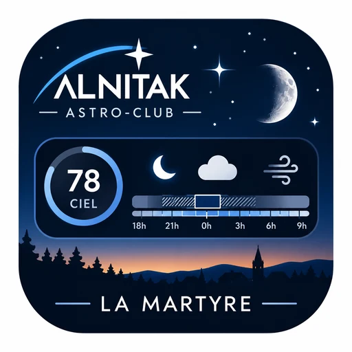

# Widgets astro « Ce soir sous les étoiles »



> **Version : Widget astro Alnitak V2** (octobre 2026) — testée et validée.

Des widgets Android ([KWGT](https://play.google.com/store/apps/details?id=org.kustom.widget), format 4×2)
qui disent d'un coup d'œil si la nuit vaut la peine de sortir le télescope :
**note du ciel, meilleur créneau, nuit noire, Lune, nuages, stabilité de l'air**,
puis **quoi observer** et **où regarder**.

Ils fonctionnent partout : seul le point d'observation est à régler, et ils peuvent
suivre la position du téléphone en déplacement.

---

## Sommaire

1. [Les trois widgets](#les-trois-widgets)
2. [Installation](#installation)
3. [Position : La Martyre ou le téléphone](#position--la-martyre-ou-le-téléphone)
4. [Mode rouge la nuit](#mode-rouge-la-nuit)
5. [Ce que montre le widget astro](#ce-que-montre-le-widget-astro)
6. [Programme de la nuit et carte du ciel](#programme-de-la-nuit-et-carte-du-ciel)
7. [Alertes du club (notifications)](#alertes-du-club-notifications)
8. [Contenu du dossier](#contenu-du-dossier)
9. [Précision et limites](#précision-et-limites)
10. [Crédits et licences](#crédits-et-licences)

---

## Les trois widgets

| Widget | Fichier | Ce qu'il montre |
|---|---|---|
| **Astro** | `astro-widget.php` | Note du ciel /100, meilleur créneau, frise de la nuit, Lune, nuages, stabilité |
| **Programme** | `programme-widget.php` | Les objets de la nuit et quand chacun est bien placé |
| **Carte du ciel** | `carte-widget.php` | Le ciel vu du site, avec les objets du programme numérotés |

Les trois passent **en rouge à la nuit tombée** pour préserver la vision nocturne.

---

## Installation

### 1. Sur le serveur

1. Régler `config.php` : nom du lieu, latitude, longitude (**ouest et sud en négatif**).
   Astuce : dans Google Maps, un appui long sur le lieu affiche les deux nombres à copier.
2. Copier le dossier `astro` sur un hébergement web **PHP 7.4 ou plus**, avec l'extension
   **GD** (et FreeType).
3. Ouvrir `https://votre-site/astro/diagnostic.php` : toutes les lignes doivent être **[OK]**.

### 2. Dans KWGT (sur le téléphone)

1. Installer [KWGT Kustom Widget Maker](https://play.google.com/store/apps/details?id=org.kustom.widget)
   depuis le Google Play Store.
2. Ajouter un widget KWGT **4×2** sur l'écran d'accueil, puis le toucher pour l'éditer.
3. Ajouter un élément **Image**. Sur la ligne **Bitmap**, cocher la case « formule » et
   coller l'adresse :

```
https://votre-site/astro/astro-widget.php?pos=auto&lat=$li(lat)$&lon=$li(lon)$&z=$df(Z)$&v=$df(yyMMddHH)$$mu(floor, df(mm)/15)$
```

4. Faire de même pour les deux autres widgets 4×2, avec ces adresses :

```
https://votre-site/astro/programme-widget.php?pos=auto&lat=$li(lat)$&lon=$li(lon)$&z=$df(Z)$&v=$df(yyMMddHH)$$mu(floor, df(mm)/15)$
https://votre-site/astro/carte-widget.php?pos=auto&lat=$li(lat)$&lon=$li(lon)$&z=$df(Z)$&v=$df(yyMMddHH)$$mu(floor, df(mm)/15)$
```

> **Bon à savoir**
> - La fin de l'adresse (`v=…`) force KWGT à recharger l'image **tous les quarts d'heure**.
>   Après une modification sur le serveur, le changement apparaît au quart d'heure suivant.
> - **Ne pas mettre d'action au toucher sur l'image** : sur certains téléphones, l'appui long
>   ne permet alors plus d'éditer le widget.
> - Pour la position du téléphone, KWGT doit avoir l'autorisation **Position**
>   (Paramètres Android → Applications → Kustom Widget → Autorisations).

---

## Position : La Martyre ou le téléphone

Chaque widget calcule le ciel soit pour le lieu de `config.php`, soit pour la position
du téléphone. Le choix se fait dans l'adresse KWGT :

| Choix | À mettre dans l'adresse |
|---|---|
| Toujours le lieu de `config.php` | rien (ou `pos=lieu`) |
| **Automatique** (conseillé) : le lieu de `config.php` à moins de 20 km, sinon le téléphone | `pos=auto&lat=$li(lat)$&lon=$li(lon)$&z=$df(Z)$` |
| Toujours le téléphone | `pos=telephone&lat=$li(lat)$&lon=$li(lon)$&z=$df(Z)$` |

- Hors du lieu de `config.php`, le widget affiche **« Ma position »**.
- Le rayon du mode automatique se règle dans `config.php` : `'rayon_auto_km' => 20`.
- `z=$df(Z)$` envoie le décalage horaire du téléphone : les heures restent justes en voyage.
- Les prévisions météo sont gardées en cache **pour chaque position** (à environ 10 km près).
- Si le téléphone ne donne pas sa position, le widget reste sur le lieu de `config.php`.
- **Les alertes du club ne changent pas** : elles portent toujours sur le lieu de `config.php`.

Pour pouvoir changer d'avis sans retoucher l'adresse : créer dans KWGT une globale texte
`position` (valeur `lieu`, `auto` ou `telephone`) et écrire `pos=$gv(position)$`.

---

## Mode rouge la nuit

Par défaut (`'theme' => 'auto'`), les widgets passent **tout seuls en rouge** quand le Soleil
descend sous `rouge_soleil_sous` (**−6°**, fin du crépuscule civil), et reviennent aux couleurs
normales le matin. Comme KWGT recharge l'image tous les quarts d'heure, la bascule se fait
au plus 15 minutes après.

Pour forcer un affichage, ajouter `theme=rouge` ou `theme=normal` dans l'adresse :

```
https://votre-site/astro/astro-widget.php?theme=rouge&v=$df(yyMMddHH)$$mu(floor, df(mm)/15)$
```

---

## Ce que montre le widget astro

### Note du ciel /100

Calculée sur la nuit sombre :

| Critère | Poids |
|---|---|
| Clarté du ciel (nuages) | 55 % |
| Absence de Lune (pondérée par sa phase) | 30 % |
| Stabilité de l'air (seeing) | 15 % |

| Note | Verdict |
|---|---|
| ≥ 70 | **Belle nuit** |
| ≥ 45 | Nuit correcte |
| ≥ 20 | Nuit médiocre |
| < 20 | Ciel bouché |

### Meilleur créneau

La plus longue période de **nuit noire**, **dégagée** (gêne nuageuse ≤ `seuil_nuages`) et
**sans Lune** (ou Lune éclairée à moins de 15 %). À défaut, le plus long créneau dégagé avec
la Lune. Au moins 45 minutes ; pendant la nuit, seule la partie restante compte.

### La frise

De 30 min avant le coucher à 30 min après le lever du Soleil :

| Élément | Signification |
|---|---|
| Fond, du clair au foncé | jour, crépuscules civil, nautique, astronomique, nuit noire |
| Trait clair | Lune levée |
| Hachures | nuages |
| Cadre | meilleur créneau |
| Trait blanc | maintenant |
| Cases sous la frise | stabilité de l'air |

En été, s'il n'y a pas de nuit noire (Soleil jamais à −18°), la nuit astronomique sert de référence.

---

## Programme de la nuit et carte du ciel

### Programme

Une ligne par objet, sur la même frise que le widget astro. La barre montre quand l'objet est
à plus de `hauteur_min_objets` degrés (25 par défaut), en plus vif pendant la nuit noire ;
le point marque sa **culmination** (son passage au plus haut).

Choix des objets (6 lignes au plus) :

- **Planètes** (Mercure à Saturne, 3 au plus) : celles qui passent au moins 30 min au-dessus
  du seuil une fois le crépuscule nautique fini.
- **Ciel profond** : les 110 objets de Messier et une trentaine d'objets NGC remarquables
  (Double amas, Dentelles du Cygne, Hélice, Œil de chat…). Un objet doit monter à 30° au moins
  et rester une heure au-dessus du seuil pendant le créneau (ou la nuit noire). Les plus beaux
  passent en premier, avec un bonus de hauteur. Quand la Lune est levée, les galaxies et
  nébuleuses reculent nettement, les amas beaucoup moins.
- Ordre d'observation : planètes, puis ciel profond par heure de culmination.

### Carte du ciel

Le ciel vu depuis le site : **zénith au centre, nord en haut et est à gauche** (comme une
carte tenue au-dessus de la tête).

- Étoiles jusqu'à la magnitude 4,2, tracés des constellations et Lune.
- Jusqu'à 4 objets du programme numérotés (au-dessus de 15°), avec leur hauteur et leur direction.
- La nuit, la carte montre le ciel du moment ; le jour, celui du milieu du créneau.
- En bas : la constellation au zénith et la Lune.

---

## Alertes du club (notifications)

`notifier.php` prévient tous les adhérents abonnés, via l'application gratuite
[ntfy](https://ntfy.sh), **au plus deux fois par nuit** :

| Alerte | Quand |
|---|---|
| **« Belle nuit ce soir à La Martyre »** | Entre `preavis_coucher_min` minutes avant le coucher du soleil (2 h par défaut) et le coucher, si la note atteint `seuil_alerte` (70) et qu'il existe un créneau dégagé. Le message donne la note, le meilleur créneau, la nuit noire, la Lune et la stabilité. |
| **« Le ciel se couvre à La Martyre »** | Si, après cette annonce, la note tombe sous `seuil_couvert` (50) ou qu'il ne reste plus de créneau dégagé d'au moins 45 min. Vérifié jusqu'à 45 min avant la fin du créneau annoncé. |

Rien n'est envoyé les autres soirs. Mémoire des envois : `cache/alertes.json`.

### Mise en place (responsable du club)

1. Dans `config.php`, choisir un `ntfy_sujet` difficile à deviner (ex. `astro-monclub-x7k2q9`)
   et une `notifier_cle` secrète.
2. Tester : ouvrir `notifier.php?cle=<notifier_cle>&essai=1` ; une notification de test doit arriver.
3. Sur [cron-job.org](https://cron-job.org) (gratuit), créer une tâche qui appelle
   `https://votre-site/astro/notifier.php?cle=<notifier_cle>` **toutes les 5 minutes**.

En ligne de commande, `php notifier.php --simulation --t=<timestamp>` montre ce qui serait
envoyé à un instant donné, sans rien envoyer.

### Pour chaque adhérent

1. Installer **ntfy** : Google Play, F-Droid ou App Store
   (liens sur la [page officielle de ntfy](https://docs.ntfy.sh/subscribe/phone/)).
2. Appuyer sur **+**, saisir le nom du sujet communiqué par le club, puis **S'abonner**.
3. Android : autoriser les notifications de ntfy quand le téléphone le demande.

> ⚠️ Toute personne qui connaît le nom du sujet reçoit les alertes : **le diffuser seulement au club**.
> Ne jamais publier un `config.php` rempli (sujet ntfy et clé) : la version publique de ce
> dossier les laisse vides.

---

## Contenu du dossier

| Fichier | Rôle |
|---|---|
| `astro-widget.php` | Image du widget astro |
| `programme-widget.php` | Image du programme de la nuit |
| `carte-widget.php` | Image de la carte du ciel |
| `astro.php` | Les données du widget astro en JSON, heure par heure |
| `objets.php` | Les objets retenus, en JSON |
| `notifier.php` | Alertes « Belle nuit » du club via ntfy (à appeler toutes les 5 min) |
| `diagnostic.php` | Vérification de l'installation |
| `config.php` | Réglages (lieu, seuils, alertes, rayon automatique…) |
| `VERSION.txt` | Nom et date de la version installée |
| `lib/Astro.php` | Positions du Soleil et de la Lune (Meeus), sans dépendance |
| `lib/Ciel.php` | Nuages, courant-jet (Open-Meteo) et seeing (7Timer), en cache |
| `lib/Nuit.php` | Frise, créneau, note |
| `lib/Lieu.php` | Choix de la position (lieu du club ou téléphone) |
| `lib/Objets.php` | Choix des objets de la nuit |
| `lib/Planetes.php` | Positions des planètes |
| `lib/Theme.php` | Couleurs normales / rouges |
| `lib/Dessin.php`, `lib/garde.php` | Dessin des images, protection contre les messages d'erreur |
| `lib/donnees/` | Catalogue d'objets, étoiles et constellations (fichiers générés) |
| `fonts/` | Police Outfit (OFL) |

---

## Précision et limites

- **Planètes** : éléments orbitaux approchés du [JPL](https://ssd.jpl.nasa.gov/planets/approx_pos.html)
  (E. M. Standish), à quelques minutes d'arc près de 1800 à 2050.
- **Soleil et Lune** : calcul local, vérifié contre [PyEphem](https://rhodesmill.org/pyephem/)
  à 1–3 minutes près (crépuscules, lever et coucher de la Lune) et à 0,1 % près pour la phase.
- **Nuages** : prévisions [Open-Meteo](https://open-meteo.com), avec leurs incertitudes.
  Les voiles hauts comptent pour 60 % de leur couverture (un cirrus gêne moins qu'une couche basse).
- **Stabilité (seeing)** : prévision de [7Timer!](http://www.7timer.info) quand elle est disponible.
  À défaut, **simple estimation** à partir du vent à 250 hPa (courant-jet) :
  < 30 nd → 5/5, < 50 → 4, < 70 → 3, < 100 → 2, au-delà → 1.
  La turbulence près du sol, le relief, la mise en température du tube et l'instrument ne sont
  pas pris en compte. `diagnostic.php` indique la source utilisée.

---

## Crédits et licences

| Élément | Source | Licence |
|---|---|---|
| Données météo | [Open-Meteo](https://open-meteo.com) | [CC BY 4.0](https://creativecommons.org/licenses/by/4.0/deed.fr) |
| Prévision de seeing | [7Timer!](http://www.7timer.info) | usage non commercial |
| Étoiles, constellations, objets Messier | [d3-celestial](https://github.com/ofrohn/d3-celestial), © 2015 Olaf Frohn | [BSD-3](https://opensource.org/license/bsd-3-clause) |
| Objets NGC | [OpenNGC](https://github.com/mattiaverga/OpenNGC), M. Verga | [CC BY-SA 4.0](https://creativecommons.org/licenses/by-sa/4.0/deed.fr) |
| Police | [Outfit](https://fonts.google.com/specimen/Outfit) | [SIL Open Font License](https://openfontlicense.org) |
| Algorithmes | J. Meeus, *Astronomical Algorithms* (2e éd.) | — |
| Notifications | [ntfy](https://ntfy.sh) | — |
